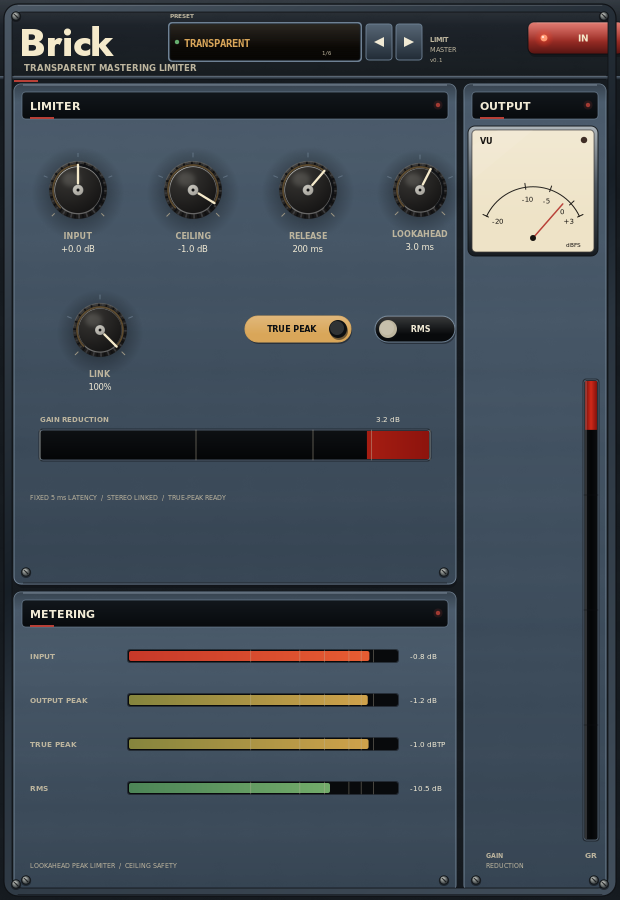

# Brick

[](https://github.com/tylorismusic-commits/brick/actions/workflows/build.yml)

**Version 0.2.0** · [GitHub](https://github.com/tylorismusic-commits/brick) · GPL-3.0-or-later

**Brick** is a free, open-source LV2/CLAP lookahead limiter for Linux: a modern,
transparent mastering limiter with optional true-peak detection and an RMS
mode, wrapped in the same slate-blue, cream, and red hardware language as the
rest of the Hearth series.



Brick is an original implementation, not an emulation or a copy of any specific
product. It is not affiliated with or endorsed by FabFilter or any other
manufacturer. The design goal is the workflow of a modern mastering limiter:
catch peaks cleanly, keep the ceiling honest, and show exactly what is
happening.

## Features

- **Transparent lookahead limiting** — a fixed 5 ms latency window, a sliding
  peak detector, and a smoothed release. The output is delayed so gain reduction
  starts before the peak arrives, and the reported latency is constant whether
  the limiter is engaged or bypassed.
- **True-peak mode** — optional 4× oversampled inter-sample peak detection
  (Catmull-Rom interpolation). The audio path stays at the host sample rate;
  only the detector is oversampled.
- **RMS mode** — a slower RMS-derived gain envelope with a fast ceiling safety
  clip. Peak mode is the default; RMS mode is smoother and more level-like.
- **Ceiling and input drive** — input gain -20…+20 dB, ceiling -20…0 dB.
- **Release and lookahead** — release 10…1000 ms, effective lookahead 0…5 ms
  inside the fixed 5 ms latency window.
- **Stereo link** — 0…100 %, with a linked minimum-gain path at 100 %.
- **Accurate metering** — input peak, output peak, output true peak, output RMS,
  and gain reduction, both in the native UI and on the host ports.
- **Host GR metering** — the LV2 build draws a live GR bar in Ardour's mixer via
  the Harrison inline-display extension. The CLAP build reports GR through
  `clap.gain-adjustment-metering`, so REAPER can show it on the track meter.
- **CLAP and LV2 builds** — same DSP, same native X11/Cairo UI.
- **Preset bar** — six starting points, applied directly through the UI, with
  matching LV2 preset resources.
- **Hidden output protection** — the limiter's safety clip guarantees the
  selected ceiling.
- **Master bypass** — separate from the host bypass, click-free, and
  latency-aligned.

## Signal flow

```
input ──▶ input gain ──▶ lookahead delay
                     └─▶ peak / true-peak detector ──▶ sliding max
                                                        │
                          gain envelope ◀── release ◀───┘
                                │
output ◀── ceiling safety ◀─────┴── delayed audio
```

The lookahead maximum is delayed so the gain for a sample is based on the peak
of the current sample and the following lookahead window. The final ceiling
clip is a safety net, not the primary limiter.

## Controls

- **Input** — drive into the limiter, -20…+20 dB.
- **Ceiling** — output ceiling, -20…0 dB.
- **Release** — recovery time, 10…1000 ms.
- **Lookahead** — effective lookahead inside the fixed 5 ms latency window,
  0…5 ms.
- **Link** — stereo link, 0…100 %.
- **True Peak** — 4× oversampled peak detection.
- **RMS** — RMS-derived gain envelope with ceiling safety.
- **IN / BYPASS** — separate plugin bypass. It does not change the host's own
  bypass state.

## Metering

- **Input** — peak level before the limiter.
- **Output Peak** — sample peak after limiting.
- **True Peak** — 4× oversampled output peak.
- **RMS** — output RMS level.
- **GR** — gain reduction, shown as a large horizontal bar and as a vertical
  meter in the output column.

The LV2 build also publishes all five values on output ports and draws GR in
Ardour's mixer via the inline-display extension. The CLAP build feeds the same
meters to the native UI and reports GR to the host.

### REAPER

Use the CLAP build for the track-meter GR display:

1. Insert **CLAP: Brick (Tylor)**.
2. Enable **Display gain reduction for plug-ins that support it** in
   *Preferences > Appearance > Track/Send Defaults* (for new tracks) or
   right-click the track meter for an existing track.
3. The red GR bar appears on the track meter in the mixer.

The LV2 build remains available; LV2 has no standard host-meter GR API, so its
GR is exposed on the output ports and through Ardour's inline display.

## Presets

| Preset | Intent |
| --- | --- |
| **Transparent Master** | Safe, open master-bus limiting with true-peak detection |
| **Loud Master** | More drive and a hotter ceiling for a competitive master |
| **Drum Bus** | Fast release and short lookahead for transient-heavy buses |
| **True Peak Safety** | Conservative true-peak ceiling for streaming delivery |
| **RMS Smooth** | Smoother RMS-derived gain with peak safety |
| **Brick Wall** | Maximum drive, minimum release and a hard ceiling |

## Skins

The swatch or `SKIN` chip in the plugin header cycles the suite skin. The free
Classic theme is built in. Additional skins can be installed in
`~/.local/share/hearth/skins/<skin>/` with a `palette.ini`; the selection is
shared across the Hearth suite and stored in `~/.config/hearth/skins.conf`.
Skins change only the UI colors and artwork, never the audio or project state.

## Build

Dependencies on Debian/Ubuntu:

```sh
sudo apt install build-essential cmake pkg-config \
  lv2-dev libcairo2-dev libx11-dev libfreetype6-dev \
  liblilv-dev libxtst-dev xvfb
```

CLAP headers are vendored in `third_party/clap` (MIT), so no external CLAP SDK
is required.

```sh
cmake -S . -B build -DCMAKE_BUILD_TYPE=Release
cmake --build build -j2
ctest --test-dir build --output-on-failure
```

For a user install:

```sh
cmake -S . -B build -DCMAKE_BUILD_TYPE=Release \
  -DCMAKE_INSTALL_PREFIX="$HOME/.local" \
  -DLV2_DIR="$HOME/.lv2" -DCLAP_DIR="$HOME/.clap"
cmake --build build -j2
cmake --install build
```

The LV2 bundle lands in `brick.lv2/`; the CLAP build is `Brick.clap` with a
`Brick.resources/` directory containing the UI module and artwork.

## Tests

The build includes four tests:

- **DSP** — ceiling, gain reduction, latency, true-peak detection, RMS mode,
  bypass, extreme settings, and multiple sample rates.
- **Host** — loads the LV2 bundle with lilv, checks ports, presets, latency,
  meters, inline display, transparency, and bypass.
- **UI** — embeds the X11 UI under Xvfb, loads a preset, drags controls, toggles
  true-peak and bypass, and captures a screenshot.
- **CLAP** — loads the CLAP build, reports GR, checks the 5 ms latency, and
  verifies UI embedding.

## License

GPL-3.0-or-later. See [LICENSE](LICENSE).

The Jost font is licensed under the SIL Open Font License 1.1; its license is
included as `assets/fonts/OFL.txt`. The knob and metal textures are original
artwork generated by the scripts in `assets/` and are included under
GPL-3.0-or-later. The CLAP headers in `third_party/clap` are MIT-licensed; see
`third_party/clap/LICENSE.md`.
